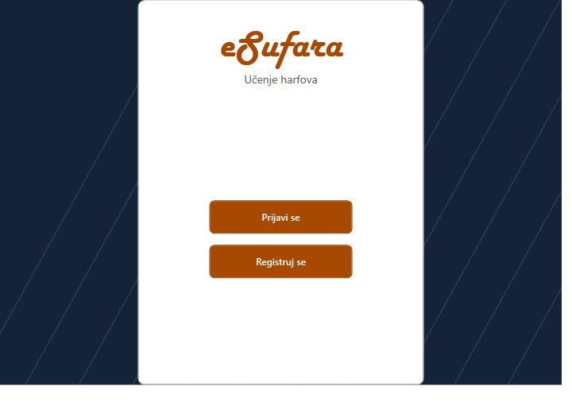

# eSufara

**C# desktop application · Second-year Object-Oriented Programming 2 project**

eSufara organizes a learning course into lessons and exercises and tracks progress per account. The original WPF implementation includes the launch screen, profile and authentication views, course navigation, media controls, and an Entity Framework Core data layer.

## Build and run

Use Windows, .NET 9 SDK and SQL Server or SQL Server Express LocalDB. From the repository root, run `dotnet build`. The default connection uses Windows integrated authentication and a separate LocalDB database named `eSufaraPortfolio`. Override it with `ESUFARA_SQL_CONNECTION` if needed.

Before using account and progress features, apply the included migrations to your own development database with the EF Core 9 CLI, using `dotnet ef database update`. Start the application with `dotnet run --project eSufara.csproj`.

The original lesson images and recordings are excluded pending redistribution verification. The application code and media loaders are included. Lesson and exercise screens expect authorized media under `Content/Lekcije` and `Content/Vezbe` in their original folder structure. This release includes original replacement artwork for the launch and default profile images.
